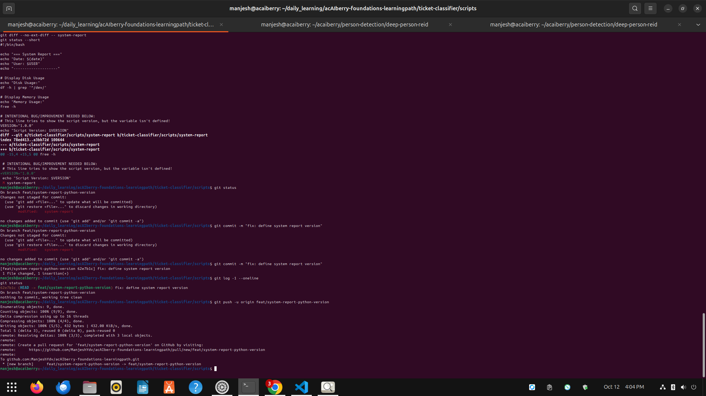

# Day 27: Use issues and pull requests

**Thu Oct 12**

**Time spent: 02:30 PM to 3:0 PM**

## Commands I practiced

```text
git add
git diff 
git commit 
git push -u origin 
git log -1 --oneline

```

## Task result
  i learn about how to craete a pull request

## Proof

Commit, file, screenshot, command output, or URL:



## Can I explain it without AI?

* [✓] Yes
* [ ] Not yet; repeat this day
